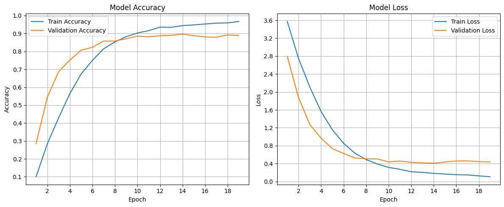

# Indian Monument Recognition with a CNN

Image classification of **49 Indian monuments** with a convolutional neural network built from scratch in TensorFlow/Keras. Course project for Machine Learning at Princess Sumaya University for Technology, where pretrained models were not allowed, so the whole network is trained from random initialization.

## Data

[I-m-Parthian/Monument-Recognition](https://github.com/I-m-Parthian/Monument-Recognition): about 1,900 training images across 49 classes (roughly 35–55 images per class) and a separate test set of 623 images. The notebook clones the dataset in its first cell.

## Approach

**Model:** 4 convolutional blocks (64 → 128 → 256 → 512 filters, 3×3 kernels, ReLU, max pooling), followed by two dense layers (512 and 256 units) with dropout 0.35 and a 49-way softmax. Input images are 400×400 RGB.

**Training:** Adam (learning rate 1e-4), categorical cross-entropy, early stopping on validation loss with best-weight restore.

**Offline data augmentation:** with so few images per class, each training image gets 5 augmented copies (rotation, zoom, horizontal flip, width and height shifts), growing the training data about six-fold.

## Results

| Setup | Test accuracy (623 images, 49 classes) |
|---|---|
| Earlier CNN version, on-the-fly augmentation only | 50% |
| CNN, offline augmentation (5 copies per image) | **58%** |

**Limitation:** the train/validation split is taken *after* the augmented copies are created, so augmented versions of the same photo can land on both sides. That makes validation accuracy (~89%) optimistic. The held-out test set has no such overlap and is the reliable measure. Splitting before augmenting, or using transfer learning from a pretrained backbone where allowed, would be the next steps.

## Run it

Open `monument_recognition_cnn.ipynb` in Google Colab (GPU runtime recommended) and run all cells.

Libraries: TensorFlow/Keras, PyTorch/torchvision (data loading for the test set), NumPy, Matplotlib.
